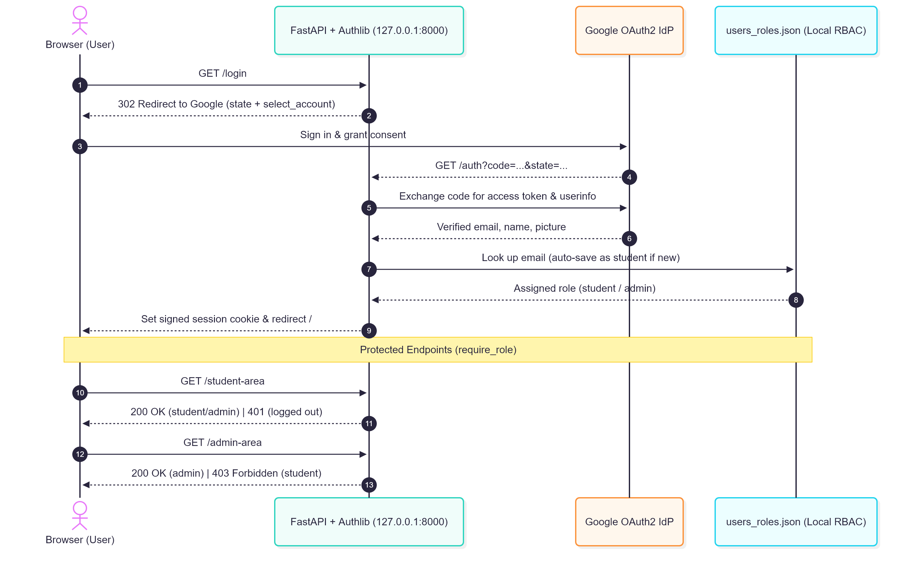

# Simple OAuth2 Login + Role-Based Access Demo

**Task 11** — Google OAuth 2.0 authentication with locally enforced role-based access control (RBAC), built with **FastAPI + Authlib**.

## Architecture

Authentication is delegated to Google using the OAuth 2.0 / OpenID Connect Authorization Code flow, handled by **Authlib**. After the callback, the backend reads the verified email from Google's UserInfo response, optionally enforces an institutional email domain, and maps the email to a local role (`student` or `admin`) stored in `users_roles.json`. A reusable FastAPI dependency (`require_role`) guards the protected routes, returning **401** for unauthenticated requests and **403** for authenticated users whose role is not allowed. First-time users are persisted to the role store with the default `student` role.



## Dependencies

- Python 3.10+
- FastAPI (`fastapi>=0.110.0`)
- Uvicorn (`uvicorn>=0.28.0`)
- Authlib (`authlib>=1.3.0`)
- Starlette session middleware via `itsdangerous>=2.1.0`
- Jinja2 (`jinja2>=3.1.0`)
- python-dotenv (`python-dotenv>=1.0.0`)
- httpx (`httpx>=0.27.0`, used by Authlib's OAuth client and by `TestClient`)

## Google Cloud Console setup (one time)

1. Create a project at <https://console.cloud.google.com/>.
2. Configure the OAuth consent screen (**External**), and add your test Google accounts under **Test users**.
3. Create **Credentials → OAuth client ID → Web application**.
4. Add the authorized redirect URI exactly as:

   ```text
   http://127.0.0.1:8000/auth
   ```

5. Copy the Client ID and Client Secret into `code/.env`.

> **Important:** Open the app at **`http://127.0.0.1:8000`** (not `http://localhost:8000`). The redirect URI and the session cookie must use the same host, otherwise the OAuth `state` check fails on the callback.

## How to run (Ubuntu / Linux, from scratch)

```bash
# 1. Enter the application directory
cd code

# 2. Create and activate a virtual environment
python3 -m venv venv
source venv/bin/activate

# 3. Install dependencies
pip install -r requirements.txt

# 4. Configure environment variables
cp .env.example .env
#    Then edit .env and set:
#      GOOGLE_CLIENT_ID=<your client id>
#      GOOGLE_CLIENT_SECRET=<your client secret>
#      SESSION_SECRET=<a long random string>
#      ALLOWED_DOMAIN=              # optional; blank allows any Google account
#      # e.g. ALLOWED_DOMAIN=iiitnr.edu.in to restrict to one domain

# 5. Edit users_roles.json and set at least one admin account, e.g.
#      { "admin1@iiitnr.edu.in": "admin", "student1@iiitnr.edu.in": "student" }

# 6. Start the server
uvicorn main:app --host 127.0.0.1 --port 8000
```

Then open <http://127.0.0.1:8000>.

`GET /login` without credentials in `.env` returns a readable **500** page instead of crashing, so configuration mistakes are obvious.

## Endpoints

| Endpoint        | Method | Access             | Behaviour                                                                         |
| --------------- | ------ | ------------------ | --------------------------------------------------------------------------------- |
| `/`             | GET    | Public             | Login status and links to protected areas                                         |
| `/login`        | GET    | Public             | Redirects to Google with `prompt=select_account`                                  |
| `/auth`         | GET    | Public             | OAuth2 callback: validates `state`, exchanges code, enforces domain, assigns role |
| `/logout`       | GET    | Public             | Clears the session                                                                |
| `/student-area` | GET    | `student`, `admin` | `401` if not logged in, `403` for other roles                                     |
| `/admin-area`   | GET    | `admin`            | `401` if not logged in, `403` for non-admins; shows the role store                |

All HTTP errors (400/401/403/404/500) are rendered as HTML by a global exception handler.